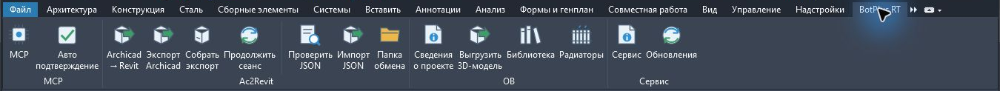

# BotPlus RT — инструменты для Revit 2026

Единая надстройка Autodesk Revit 2026 x64. На вкладке **BotPlus RT** расположены три панели:

| Панель | Назначение |
| --- | --- |
| **MCP** | Локальный MCP-мост: работа с моделью, видами, листами, аннотациями и ресурсами проекта из AI-клиента. Подключение и переключатель автоподтверждения. |
| **Ac2Revit** | Перенос модели из открытого Archicad через Tapir и IFC: экспорт, продолжение сеанса, подготовка, импорт и проверка JSON. |
| **ОВ** | Экспорт помещений и ограждений, интерактивная 3D-модель, расчёт теплопотерь по Poteri и подбор отопительных приборов. |

Дополнительная панель **Сервис** показывает версию и проверяет обновления на GitHub.



В версии **1.6** рельеф Mesh переносится в Toposolid вместе с моделью: флажок включён по умолчанию. В окне переноса задаются папка и имя RVT. После сохранения рядом с моделью записываются подробные `*.botplus-import.log` и `*.botplus-import.json`. Обновления скачиваются из официального репозитория с проверкой SHA-256. [Дорожная карта](ROADMAP.md) содержит следующие задачи; [первичный аудит Каспийска](docs/KASPIYSK-AUDIT.md) — подтверждённые наблюдения и оставшиеся проверки.

[USAGE.md](USAGE.md) описывает каждую кнопку, форматы JSON / IFC / комбинированный экспорт, выбор категорий и восстановление сеансов. [Сравнение с OOXGN RevitMCP](docs/UPSTREAM-MCP.md) фиксирует проверенные отличия и перенесённые проверки.

Это объединение развивающихся инструментов. Поддержка конкретных элементов Archicad зависит от адаптера; часть геометрии передаётся как DirectShape. Инженерные результаты ОВ требуют проверки исходных данных и расчёта. Объединение само по себе не подтверждает полный перенос произвольного PLN и нормативную пригодность расчёта.

## Установка

Запустите **BotPlus.RT-1.6-Setup.exe** из `dist` или опубликованной поставки. Закройте Revit перед установкой. Установка выполняется для текущего пользователя, без прав администратора. Node.js, MCP-сервер, CPython 3.12, библиотеки IFC и четыре семейства/шаблона Ac2Revit включены. Отдельная установка SDK, Node.js и Python не требуется.

Для переноса PLN нужен установленный Archicad. Установщик предлагает Tapir для Archicad 25–30 (по умолчанию 28) или пропуск установки. Закройте выбранный Archicad; запись Tapir в Program Files может запросить права администратора. Для 3D в HTML-просмотрщике ОВ нужен доступ к CDN Three.js.

[Подробная установка и удаление](docs/INSTALLATION.md) · [Архитектура](docs/ARCHITECTURE.md) · [Происхождение и перенос](docs/MIGRATION.md) · [Проверки](docs/VALIDATION.md).

## Структура

```text
src/BotPlus.RT/         единая точка загрузки и порядок панелей
modules/codex-mcp/      исходники WEAM.Revit.AI, сервер MCP и его тесты
modules/ac2revit/       C#, Python, контракты, семейства, тесты транслятора
modules/ov/            HeatLossViewer: экспорт, просмотрщик, расчёт, тесты
installer/             самостоятельный Windows EXE, установка и удаление
scripts/               упаковка Node.js/Python и проверки
docs/                  общая документация
dist/                  готовый EXE, исходники ZIP, SHA256SUMS (вне Git)
Входные данные/        исходные модели, частные шаблоны и первоначальный архив (вне Git)
Выходные данные/       установщики, сборочные данные и проверки (вне Git)
local/, dist/, artifacts/ совместимые пути через локальные ссылки (вне Git)
```

Модули включены непосредственно в репозиторий: сборка не зависит от доступности прежних GitHub-репозиториев. Их внутренние пространства имён и MCP-ключ `weam_revit_ai` сохранены для совместимости. Корневые инструкции и сборочные скрипты имеют приоритет над историческими инструкциями отдельных модулей.

## Сборка

Требуются Windows x64, Revit 2026 с API, .NET SDK 10.0.401 (целевая платформа плагинов — .NET 8), Node.js и pnpm. Для упаковки нужен CPython 3.12 x64 с зависимостями из `modules/ac2revit/requirements.txt`.

```powershell
.\build.ps1
.\build-installer.ps1 -BuildPython 'D:\build-env\Scripts\python.exe'
.\scripts\test.ps1 -BuildPython 'D:\build-env\Scripts\python.exe'
```

На исходном рабочем компьютере `build-installer.ps1` по умолчанию использует перенесённую среду в `local/legacy/Ac2Revit/.ifc-env`. Все продукты сборки пишутся в этот репозиторий. Путь к другой установке Revit передаётся параметром `-RevitInstallDir`.

## Лицензия

GNU AGPL-3.0-only, см. [LICENSE](LICENSE). Сохранены исходные уведомления WEAM.Revit.AI. Python, Node.js, .NET и Python/npm-зависимости распространяются со своими лицензиями и уведомлениями в поставке. Autodesk Revit, Archicad и частные шаблоны не включены. Установщик содержит официальные Tapir 1.8.0 для Archicad 25–30 с лицензией и контрольными суммами. Четыре RFA/RFT Ac2Revit входят в исходники и поставку; пользовательские модели и секреты исключены.
